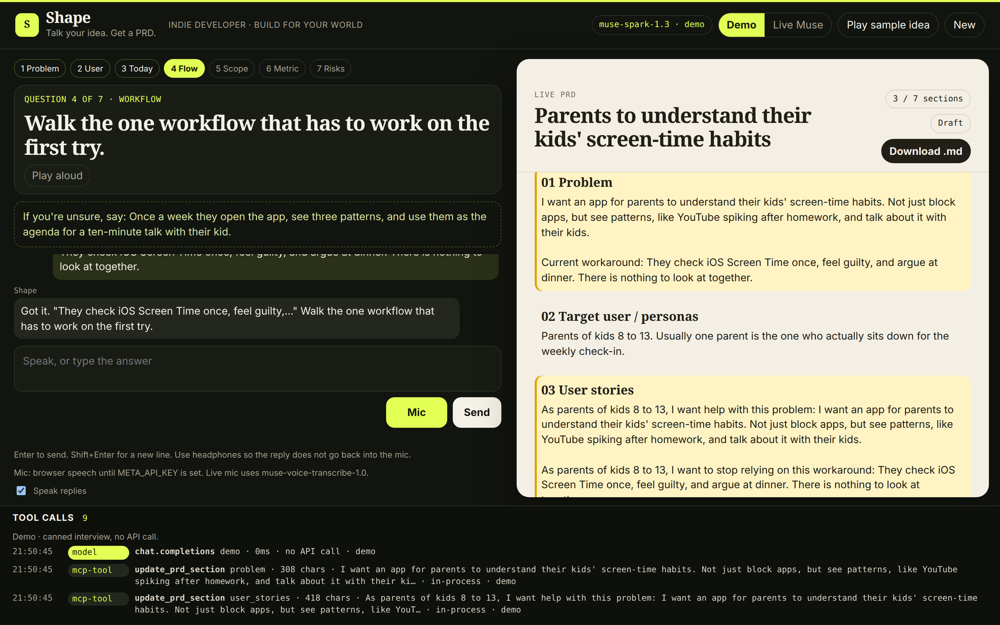
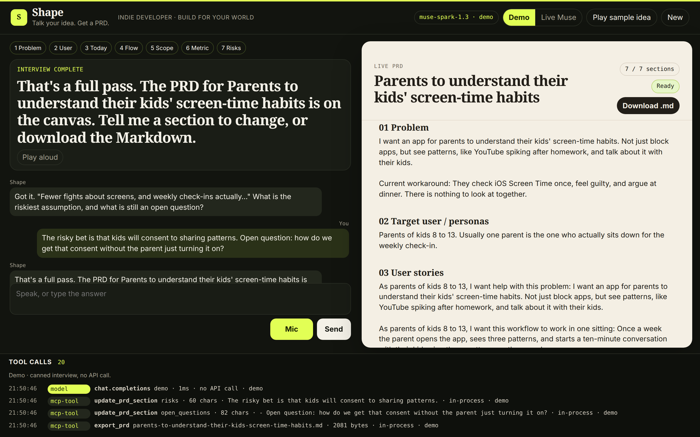
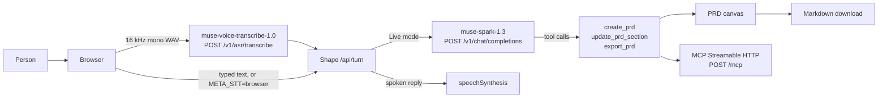

# Shape

Talk through a product idea. Shape interviews you like a sharp PM, one question at a time, and writes the PRD on screen while you talk.





**Track:** Indie Developer. **Theme:** Build for Your World.
**Built with Meta Muse models** via the [Meta Model API](https://dev.meta.ai) for the Meta Global AI Developer Hackathon (October 26–November 4, 2026).

Demo video: [TO FILL]

## Quickstart

Node 20 or newer. No install step.

```bash
git clone https://github.com/vinayguda/shape-voice-meta-hackathon.git
cd shape-voice-meta-hackathon
make dev
```

Open http://localhost:3000. Leave the toggle on **Demo** and click **Play sample idea**, or hold **Mic** (Chrome) and answer out loud. **Download .md** saves the PRD.

`make dev` is the whole app: one Node process serves the UI, the interview, and the MCP endpoint. Demo mode does not call the network.

Live Muse, when you have a key:

```bash
cp .env.example .env   # set META_API_KEY
make dev               # toggle Live Muse in the header
```

`make check` runs the scripted interview, the no-key guard, and the MCP tools.

## Hackathon

| | |
|---|---|
| Track | Indie Developer |
| Theme | Build for Your World |
| Window | October 26–November 4, 2026 |
| Entrant | Vinay Guda (solo) |
| Models | `muse-spark-1.3` on every live turn. `muse-voice-transcribe-1.0` on every mic clip when a key is set. |

Shape is for the builder who can explain an idea out loud and still walks into a blank doc. The interview asks the questions that usually get skipped, and the canvas is the spec at the end of the conversation.

## Built with Meta Muse models via Meta Model API

Base URL `https://api.meta.ai/v1`. Auth `Authorization: Bearer $META_API_KEY`. Chat Completions is OpenAI-compatible. No other LLM is called.

| Model id | Job | Where |
|---|---|---|
| `muse-spark-1.3` (override with `META_MODEL`) | Interview, follow-ups, pushback, slot extraction, PRD drafting, tool calls | `server/muse.js` `museChat` → `POST /v1/chat/completions`, called from `server/interview.js` on every **Live** user turn |
| `muse-voice-transcribe-1.0` | Speech-to-text for the mic | `server/muse.js` `transcribeWav` → `POST /v1/asr/transcribe`. 16 kHz mono WAV. `audioEncoding` is `WAV`. |

Muse Spark is a reasoning model. Reasoning tokens count against `max_tokens`. A cap of 20 comes back as `content: null` and `finish_reason=length`, so the default cap is **4000** (`META_MAX_TOKENS`). Shape sends `reasoning_effort=low` unless `META_REASONING_EFFORT=off`. If that field returns HTTP 400, the next attempt drops it for the rest of the process. Turns are not streamed: the spoken line is ready only after the tool calls, and the thinking time is already most of the 1.5–3s.

The mic is push-to-talk. The browser records a clip, resamples it to 16 kHz mono WAV, and Shape posts it to `POST /v1/asr/transcribe`. That call is verified: HTTP 200, transcript in `transcript`, about 1–2 seconds for a 4 second clip. The JSON part must be exactly `{"model":"muse-voice-transcribe-1.0","audioEncoding":"WAV","sampleRateHertz":16000}`. `audioEncoding` is case-sensitive (`wav`, `LINEAR16`, and `PCM_S16LE` return 400). `POST /v1/audio/transcriptions` returns 404, and the realtime WebSocket is not used. Each clip is a row in the tool log (`asr/transcribe`).

`META_STT=browser` forces the Web Speech API instead. With no API key the mic uses that same browser fallback so Demo mode still runs. Meta does not ship text-to-speech here, so replies use `speechSynthesis`.

The header pill and the tool log show the model id, latency, and reasoning-token count on live turns.

## How it works



Demo mode walks the same graph and the same tool executor with canned replies, so the UI still runs if the key is missing or the API flakes. Switch the header to **Live Muse** and the next answer is a real `muse-spark-1.3` call. The opening question is the first branch of the graph and does not spend a request. Every answer after that does.

The graph, one question at a time: problem → target user → current workaround → workflow → MVP scope in and out → success metrics → risks and open questions. Shape offers a recommended answer you can tap, and it pushes back on "everyone," a platform-sized scope, a metric with no number, and one-word answers.

PRD sections on the canvas: Problem, Target user / personas, User stories, MVP scope, Success metrics, Risks, Open questions.

### MCP

The three PRD actions are real tools. The interview runs them in-process through the same function the MCP server exposes, so a turn does not hop over HTTP to itself. `POST /mcp` speaks Streamable HTTP (JSON-RPC, `MCP-Protocol-Version: 2025-03-26`).

```bash
curl -s http://localhost:3000/mcp \
  -H 'content-type: application/json' \
  -H 'accept: application/json, text/event-stream' \
  -d '{"jsonrpc":"2.0","id":1,"method":"tools/list"}'
```

`tools/call` accepts `create_prd`, `update_prd_section`, and `export_prd`. Pass `sessionId` to aim at an interview session, or omit it to use the default MCP session.

### Voice choice

LiveKit Agents would work, and the earlier Voice Agent Studio project was built that way. This repo does not copy that code. Shape stays one Node process: the browser records, Muse Voice Transcribe transcribes, Muse Spark interviews, and `speechSynthesis` speaks. Use headphones so the reply does not walk back into the mic. Typing and **Play sample idea** cover a machine with no microphone. Set `META_STT=browser` if you want the Web Speech API instead of Muse.

## Inspiration

- **Matt Pocock's grill-me skill.** It interviews you one question at a time, walks each branch of the decision tree, and offers a recommended answer until there is shared understanding. Shape keeps that discipline and does it by voice. See [mattpocock/skills](https://github.com/mattpocock/skills).
- **[grill-with-ui](https://github.com/jasonku09/grill-with-ui).** An agent-agnostic grilling interview on a local browser page instead of a terminal. Shape's twist is the real-time voice agent and the PRD canvas filling in beside the transcript.

## What existed before

Voice-studio patterns (a session you can talk to, a visible log of model and tool activity) come from the author's earlier Voice Agent Studio project, a LiveKit admin console and playground. Everything in this repository was written during the hackathon window, October 26–November 4, 2026. There is no employer code here.

## What's next

Not in this build:

- Phone-call handoff, so a session can leave the browser for a phone call.
- WhatsApp in the middle of a call.
- A research tool the agent can call when a claim needs a source.

## Env

See `.env.example`. The names that matter:

| Variable | Purpose |
|---|---|
| `META_API_KEY` | Bearer token for the Meta Model API. `MODEL_API_KEY` is also accepted. |
| `META_BASE_URL` | `https://api.meta.ai/v1` |
| `META_MODEL` | `muse-spark-1.3` |
| `META_MAX_TOKENS` | Default 4000. Do not set this near 20. |
| `META_REASONING_EFFORT` | Default `low`. `off` disables it. |
| `META_STT` | Unset uses Muse Voice Transcribe when a key is set. `browser` forces the Web Speech API. |
| `META_STT_MODEL` | Default `muse-voice-transcribe-1.0`. |
| `DEMO` | `1` forces the canned interview even if a key is set. |

The browser never sees the key. `/api/health` reports only whether a key is present.

## License

MIT. Copyright 2026 Vinay Guda.
